<!-- SEO Meta Tags -->
<meta name="description" content="Awesome Agent-Native Inbox - Curated list of SaaS platforms and open-source infrastructure for AI agent programmatic inboxes, inbound parsing, email APIs, and deterministic capability gating.">
<meta name="keywords" content="Agent-Native Inbox, AI Agents, Email Infrastructure, Programmatic Email, Inbound Webhooks, Model Context Protocol, MCP Email, LangChain Email, Cloudflare Workers Email, Mailpit, Autonomous Agents, Agent Mail">

<p align="center">
  
</p>

<h1 align="center">📬 Awesome Agent-Native Inbox 🤖</h1>

<p align="center">
  <strong>Curated ecosystem of SaaS platforms, developer APIs, and open-source projects for programmatic agent inboxes, inbound parsing &amp; autonomous email infrastructure.</strong>
</p>

<p align="center">
  <a href="https://github.com/ishandutta2007/Awesome-Awesome-Awesome"></a><a href="https://discord.gg/jc4xtF58Ve"></a>
  <a href="https://github.com/ishandutta2007/Awesome-Agent-Native-Inbox/stargazers"></a>
  <a href="https://github.com/ishandutta2007/Awesome-Agent-Native-Inbox/network/members"></a>
  <a href="https://github.com/ishandutta2007/Awesome-Agent-Native-Inbox/blob/main/LICENSE"></a>
  <a href="https://github.com/ishandutta2007/Awesome-Agent-Native-Inbox/pulls"></a>
  <a href="https://github.com/ishandutta2007"></a>
</p>

---

## 📖 Overview

This repository tracks notable **SaaS platforms** and **open-source projects** for **Agent-Native Inboxes**. Unlike human-centric email clients that rely on OAuth and interactive UIs, agent-native inboxes equip autonomous AI agents with their own programmatic email addresses and API-first mailbox management. This unlocks autonomous OTP/magic-link verification, customer support triage, multi-agent communication, structured document extraction, and background workflow triggers without the limitations or account suspensions typical of consumer email providers.

### 🌟 Key Highlights
- 🤖 **Autonomous Inboxes**: Dynamic mailbox provisioning via REST APIs, SDKs (Python, TypeScript, Go), and MCP (Model Context Protocol).
- ⚡ **Real-Time Delivery**: Sub-second webhook notifications and WebSocket feeds for inbound email parsing.
- 🛡️ **Deterministic Security**: Zero-trust capability gating, prompt injection delimiters, sender allowlists, and execution sandboxing outside the LLM context.
- 🌐 **Open & Self-Hosted**: Comprehensive coverage of open-source backends running on Cloudflare Workers, Docker, Rust, and Python.

---

## 📑 Table of Contents

- [📊 Sector Overview & Market Dynamics](#-sector-overview--market-dynamics)
- [☁️ SaaS & Hosted Platforms](#️-saas--hosted-platforms)
- [🔓 Open-Source GitHub Projects](#-open-source-github-projects)
- [🏗️ Recommended Architectural Stacks](#️-recommended-architectural-stacks)
- [🤝 How to Contribute](#-how-to-contribute)
- [🛡️ Disclaimer & Security Guidelines](#️-disclaimer--security-guidelines)
- [  Star History](#--star-history)
- [💖 Support & Community](#-support--community)

---

## 📊 Sector Overview & Market Dynamics

The autonomous AI agent and programmatic communications infrastructure market is projected to surge from **$5.1 billion in 2024 to over $47.1 billion by 2030**, representing a compound annual growth rate (**CAGR**) exceeding **44%**, as enterprise workflows transition from human copilot interactions to autonomous background execution.

At present, the Agent-Native Inbox sector is **moderately fragmented**:
- **Legacy & CPaaS Incumbents** (e.g., Nylas, Twilio SendGrid, ActiveCampaign Postmark) dominate traditional enterprise email sync and transactional sending pipelines.
- **Agent-First Native Startups** (e.g., AgentMail, OpenMail, Sequenzy) are aggressively capturing the greenfield space with API-first mailbox provisioning, native Model Context Protocol (MCP) servers, and instant webhook replies.
- Because agent communication requires specialized security barriers—such as deterministic capability gating and automated OTP handling—the market is currently in an open land-grab phase rather than a mature, winner-take-all monopoly, leaving substantial room for both specialized SaaS providers and self-hosted open-source architectures to flourish.

---

## ☁️ SaaS & Hosted Platforms

The following hosted solutions provide turnkey agent email infrastructure, managed domain reputations, and developer-friendly APIs. The table below is sorted descending by **Company Size / Valuation**.

| Product 🏷️ | Description & Agent Capabilities 🛠️ | Company Size / Valuation 💰 | Starting Pricing 💳 | Free Tier / Trial Limits 🎁 |
| :--- | :--- | :--- | :--- | :--- |
| **[Superhuman AI](https://superhuman.com/)** | AI-native email productivity suite for Google Workspace and Microsoft 365. Features split inboxes, autonomous message drafting, conversational search ("Ask AI"), and rapid triage workflows. | **$825M Valuation** ($108M total venture funding raised) | **$30 / user / month** ($25/user/month billed annually) | **30-day free trial** with live 1-on-1 concierge onboarding (no permanent free tier) |
| **[Nylas Agent Accounts](https://www.nylas.com/)** | Universal communications platform providing hosted agent mailboxes with integrated calendar sync. Eliminates OAuth complexity with direct programmatic mailbox provisioning and webhook callbacks. | **$500M–$1B Valuation** ($175M funding, ~$75M ARR) | **$15 / month** (Full Platform Plan; includes 5 connected accounts, $2.00/extra account) | **Free forever Sandbox**: 5 connected accounts, core Email/Calendar/Contacts APIs, unlimited test calls (no credit card required) |
| **[Mailtrap](https://mailtrap.io/)** | Complete email platform combining transactional Email API sending with an isolated Email Sandbox for development and testing. Offers inbound parsing and multi-tenant webhook notifications. | **~$100M+ Valuation** (~$20M+ ARR, bootstrapped by Railsware, 1M+ developer accounts) | **$15 / month** (Basic Sending Plan for 10,000 emails/month; Sandbox Basic starts at $14.99/mo) | **Free forever plan**: 4,000 emails/month (150 emails/day cap, 1 domain) for sending + 100 test emails/month in 1 sandbox inbox |
| **[Shortwave](https://www.shortwave.com/)** | AI assistant email client built atop Gmail infrastructure. Uses LLMs for semantic search across years of history, multi-thread synthesis, personalized drafting, and automated scheduling. | **~$40M–$50M Valuation** ($9M seed funding from USV & Lightspeed) | **$18 / user / month** (Personal Pro plan; 3-year AI search history, AI web browsing) | **Free forever plan**: 90-day search history, daily AI assistant query quota, max 15 threads/search, Shortwave signature (plus 14-day trial of paid tiers) |
| **[AgentMail](https://agentmail.to/)** | The premier API-first email provider custom-built for AI agents. Features dynamic inbox creation via API, real-time webhooks/WebSockets, automated parsing, MCP server, and SDKs for Python, TypeScript, and Go. | **~$30M Valuation** ($6M seed funding, Y Combinator-backed) | **$20 / month** ($16/month billed annually; Developer Plan: 10 inboxes, 10,000 emails/month, 10 custom domains) | **Free forever plan**: 3 inboxes, 3,000 emails/month, 100 emails/day cap, 3 GB storage, 2 organization seats, `@agentmail.to` domain (no credit card required) |
| **[Mailforge](https://mailforge.com/)** | High-volume mailbox provisioning infrastructure for outbound agents and autonomous sales workflows. Features automated SPF, DKIM, and DMARC record generation, official CLI, and native MCP support. | **~$8M–$10M Valuation** ($1.5M funding, ~$2M ARR by Salesforge) | **$30 / month** ($3/mailbox slot/month with a 10 mailbox slots minimum order) | **Free workspace preview mode**: full dashboard & DNS architectural setup access with 0 active provisioned mailboxes (sending requires paid slot activation) |
| **[OpenMail](https://openmail.ai/)** | Privacy-first, EU-headquartered agent email infrastructure engineered for GDPR compliance. Delivers sub-500ms webhook replies, two-way threading, RAG-ready attachment extraction, and LangChain/Vercel AI SDK integration. | **~$3M–$5M Valuation** (Seed-funded European venture) | **€9 / month** (~$9.70/mo; Developer Plan: 10 inboxes, 10,000 emails/month, 10 GB storage, custom domains) | **Free forever plan**: 3 inboxes, 3,000 emails/month, 100 emails/day cap, 3 GB storage, 2 organizations (no credit card required) |
| **[Sequenzy](https://sequenzy.com/)** | AI-native email automation platform combining transactional APIs, visual workflow builders, and agent inboxes. Features MCP tools, unlimited sending domains, and real-time webhook listeners. | **~$2M–$4M Valuation** (Venture-backed seed) | **$19 / month** (Pro Plan; unlimited contacts and domains, visual automation builder, transactional API) | **Free forever plan**: 2,500 emails/month, unlimited contacts, unlimited sending domains, AI assistant access, Sequenzy footer |
| **[Bavimail](https://bavimail.com/)** | Developer-focused email infrastructure delivering programmatic mailbox APIs for agents. Features inbound webhook routing, SPF/DKIM/DMARC handling, and multi-tenant agent organization isolation. | **~$1.5M–$3M Valuation** (Bootstrapped / Pre-seed) | **$4 / month** (Developer Plan; 50,000 emails/month, custom domains, REST API access) | **Free forever plan**: 6,000 emails/month, 200 emails/day cap, 3 inboxes per domain, 0.5 GB storage (no credit card required) |
| **[Sidemail](https://sidemail.io/)** | All-in-one email service with an official MCP server. Features inbound email webhooks, transactional sending, Markdown template rendering, detailed deliverability logs, and 90-day searchable message history. | **~$1M–$2M Valuation** (~$300k ARR, bootstrapped indie by Robolly team) | **$19 / month** ($14/month billed annually; all-inclusive 1,000 emails/month base tier) | **7-day free trial**: 1,000 emails allowance, full API & MCP server access, no credit card required |

---

## 🔓 Open-Source GitHub Projects

For engineering teams seeking total data sovereignty, zero vendor lock-in, and self-hosted control, these active open-source projects power production-grade agent mailboxes, SMTP servers, testing utilities, and security sidecars. 

The list below is sorted descending by **GitHub Stars**:

1. **[docker-mailserver](https://github.com/docker-mailserver/docker-mailserver)** [](https://github.com/docker-mailserver/docker-mailserver/stargazers)  
   Production-ready, fullstack containerized mail server image (Postfix, Dovecot, ClamAV, SpamAssassin, OpenDKIM). Widely deployed as the robust private backend for self-hosted agent sidecars and Maildir watchers.

2. **[Postal](https://github.com/postalserver/postal)** [](https://github.com/postalserver/postal/stargazers)  
   Fully featured, open-source mail delivery platform and HTTP/SMTP API for inbound routing and outbound transactional dispatch. Serves as a self-hosted alternative to SendGrid and Mailgun with granular webhook triggers.

3. **[MailHog](https://github.com/mailhog/MailHog)** [](https://github.com/mailhog/MailHog/stargazers)  
   The classic developer email testing tool. Provides a lightweight SMTP server with an integrated web UI and JSON REST API to verify transactional emails and agent triggers during development.

4. **[Stalwart Mail Server](https://github.com/stalwartlabs/stalwart)** [](https://github.com/stalwartlabs/stalwart/stargazers)  
   Next-generation, all-in-one open-source mail server written in Rust. Features native JMAP, IMAP4, SMTP, and REST APIs, built-in full-text search, automated Let's Encrypt TLS, and enterprise-grade security filters—ideal as an ultra-fast agent communication backbone.

5. **[Mailpit](https://github.com/axllent/mailpit)** [](https://github.com/axllent/mailpit/stargazers)  
   Modern, blazing-fast email and SMTP testing tool written in Go (successor to MailHog). Capable of handling 100–200 emails/second, with modern web UI, REST API, link checking, spam assessment (via SpamAssassin), and webhook forwarding for automated agent test suites.

6. **[Agentic Inbox (Cloudflare)](https://github.com/cloudflare/agentic-inbox)** [](https://github.com/cloudflare/agentic-inbox/stargazers)  
   Self-hosted AI email client running entirely on Cloudflare Workers and Workers AI. Automatically ingests inbound emails, summarizes content, extracts action items, and triggers downstream workflows directly at the edge with zero server maintenance.

7. **[Inbucket](https://github.com/inbucket/inbucket)** [](https://github.com/inbucket/inbucket/stargazers)  
   Disposable email testing service supporting SMTP, POP3, IMAP, and REST API interfaces. Allows programmatic generation of disposable addresses on the fly for verification and ephemeral agent testing.

8. **[Caspian SDK](https://github.com/TryCaspian/caspian-sdk)** [](https://github.com/TryCaspian/caspian-sdk/stargazers)  
   Open-source agent communication layer SDK in Python and TypeScript. Standardizes agent messaging across Email, WhatsApp, Slack, Discord, Telegram, and SMS through a single unified interface.

9. **[Pizza Bot (AWS)](https://github.com/pizza-bot-app/pizza-bot)** [](https://github.com/pizza-bot-app/pizza-bot/stargazers)  
   Local-first inbox for long-running AI agents built with LangGraph and DeepAgents. Features checkpointed thread persistence, SQLite storage, persistent memory across threads, and approval gates for tool execution.

10. **[AgentTeam Email](https://github.com/agentteamhq/agentteam-email)** [](https://github.com/agentteamhq/agentteam-email/stargazers)  
    Open-source email infrastructure designed specifically for AI agents. Combines Cloudflare Workers, Cloudflare R2 storage for attachments, Docker Compose setups, and pre-built tool definitions for LangChain and AI SDKs.

11. **[dearagent](https://github.com/panda-sandeep/dearagent)** [](https://github.com/panda-sandeep/dearagent/stargazers)  
    Self-hosted email inbox API for AI agents running on Cloudflare Workers (an open-source AgentMail alternative). Features virtual inboxes, message threads, long-polling, full-text search, HMAC webhook verification, and an MCP server at `/mcp`.

12. **[NornWeave](https://github.com/DataCovey/nornweave)** [](https://github.com/DataCovey/nornweave/stargazers)  
    Self-hosted Inbox-as-a-Service API for AI agents. Converts inbound webhooks from Mailgun, SES, SendGrid, and Resend into stateful conversations with HTML-to-Markdown parsing, automatic threading, pgvector semantic search, and an MCP server for Claude and Cursor.

13. **[docker-mailagent](https://github.com/vrag99/mailagent)** [](https://github.com/vrag99/mailagent/stargazers)  
    LLM-powered email agent sidecar for `docker-mailserver`. Monitors Maildir inboxes using `inotify`, classifies incoming messages across 5 LLM providers (OpenAI, Anthropic, Gemini, OpenRouter, Groq), and triggers composable actions (reply, webhook, notify).

14. **[emalia](https://github.com/CoronRing/GS-Emalia)** [](https://github.com/CoronRing/GS-Emalia/stargazers)  
    Security-first agent email framework operating under the axiom that *"an inbox is an unauthenticated public endpoint."* Implements strict sender allowlists, capability gating outside the LLM, credential sandboxing, and prompt-injection defense barriers.

---

## 🏗️ Recommended Architectural Stacks

Building a custom, production-grade agent email stack often requires combining several specialized tools:

```text
┌─────────────────────────────────────────────────────────────────┐
│                    Autonomous AI Agent                          │
│               (LangChain / Vercel AI / Claude)                  │
└───────────────▲─────────────────────────────────▲───────────────┘
                │ MCP / REST                      │ Execution Hook
┌───────────────▼────────────────┐   ┌────────────▼───────────────┐
│       Inbox API Layer          │   │  Deterministic Security    │
│  (NornWeave / dearagent /      │   │          (emalia)          │
│   AgentMail / OpenMail)        │   │ • Allowlist Gating         │
│ • State & Threading            │   │ • Prompt-Injection Defense │
│ • Markdown & Attachment OCR    │   │ • Sandboxed Capability     │
└───────────────▲────────────────┘   └────────────────────────────┘
                │ Webhooks / Inbound
┌───────────────▼────────────────┐   ┌────────────────────────────┐
│      Mail Server Backbone      │   │    CI / Testing Rig        │
│ (Stalwart / docker-mailserver /│   │ (Mailpit / pytest-mailpit) │
│  Postal / Cloudflare Workers)  │   │ • End-to-end OTP flow test │
│ • SMTP / IMAP / JMAP           │   │ • 100-200 msg/sec load     │
└────────────────────────────────┘   └────────────────────────────┘
```

1. **Lightweight Edge Stack**: Deploy **Cloudflare Agentic Inbox** or **dearagent** on Cloudflare Workers for near-zero latency, edge compute, and automated TLS.
2. **Enterprise Self-Hosted Stack**: Run **Stalwart Mail Server** (or **docker-mailserver**) as the mail transport agent, layer **NornWeave** for PostgreSQL threading & pgvector semantic search, and front it with **emalia** for external prompt-injection gating.
3. **Continuous Integration & Testing**: Pair **Mailpit** with **pytest-mailpit** to validate agent OTP retrieval, link extraction, and auto-reply formatting without sending messages to external networks.

---

## 🤝 How to Contribute

Contributions are welcome and celebrated! To contribute a new SaaS tool or open-source repository:

1. 🍴 **Fork the repository** on GitHub.
2. 🌿 **Create a feature branch**: `git checkout -b feature/add-new-agent-inbox`.
3. 📝 **Add your entry** to `README.md`:
   - For **SaaS tools**: Provide exact starting pricing, precise free tier/trial limits, and company size/valuation.
   - For **Open-Source projects**: Include the official GitHub repository link, star badge, license, and architectural highlights.
4. 🚀 **Submit a Pull Request** with a brief summary explaining the project's significance to agent email workflows.

---

## 🛡️ Disclaimer & Security Guidelines

- **Community Curation**: This is a community-maintained index; listings do not represent commercial endorsements.
- **Regulatory Compliance**: Autonomous agents that ingest or transmit emails must adhere to data privacy regulations (GDPR, CCPA, CAN-SPAM) and email authentication standards (SPF, DKIM, DMARC).
- **Prompt Injection Defense**: Public agent inboxes are unauthenticated network attack vectors. Always enforce capability gating, strict sender allowlists, and credential access boundaries outside the model context before parsing arbitrary inbound email text.

---

##  Star History

[](https://star-history.dera.page/#ishandutta2007/Awesome-Agent-Native-Inbox&type=date&legend=top-left)

---

## 💖 Support & Community

Thank you so much for exploring and supporting the **Awesome Agent-Native Inbox** ecosystem! 🙏

If this project helps you build better, faster, and more autonomous AI agents, please consider supporting the project:
- ⭐ **Star this repository** to help other engineers discover it
- 🍴 **Fork and share** with your developer network and AI platform teams
- ☕ **Sponsor our research & development**: Back future open-source projects via the [GitHub Sponsor Dashboard](https://github.com/sponsors/ishandutta2007)

---

<p align="center">
  <sub>Maintained with ❤️ by <a href="https://github.com/ishandutta2007">Ishan Dutta</a> and the open-source AI community.</sub>
</p>

<!-- SEO Keywords (Hidden)
Agent-Native Inbox, Programmatic Email, AI Agents, Autonomous Inbox, Email API, Inbound Webhooks, Model Context Protocol, MCP Email, Stalwart Mail, AgentMail, OpenMail, Nylas Agent Accounts, Superhuman AI, Mailtrap, Shortwave, Docker Mailserver, Mailpit, MailHog, Postal, Caspian SDK, Pizza Bot, Prompt Injection Defense, Capability Gating, LangGraph Email, Vercel AI SDK Email, Curated List, Awesome List
-->
